# gwAnd

[Deutsch](README.md) · **English**

Native Android app for phones and tablets for [Gramps Web](https://www.grampsweb.org/). gwAnd talks directly to the
Gramps Web API (3.0 or later), without a server part of its own, and works with self-hosted and hosted instances alike.

Not an official Gramps or Gramps Web project.

<p>
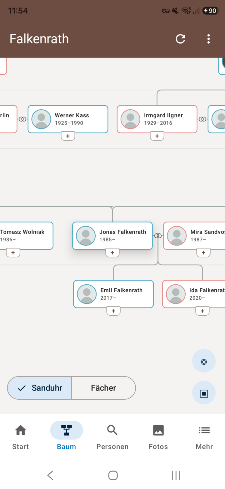
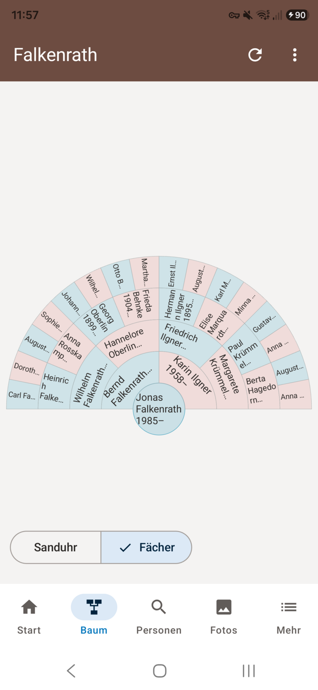
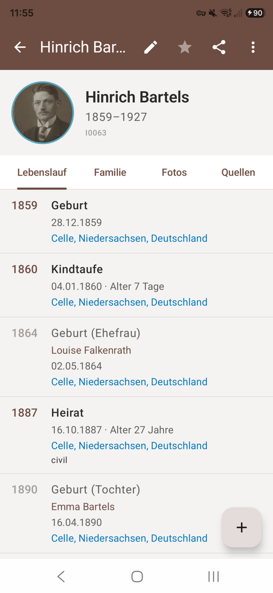
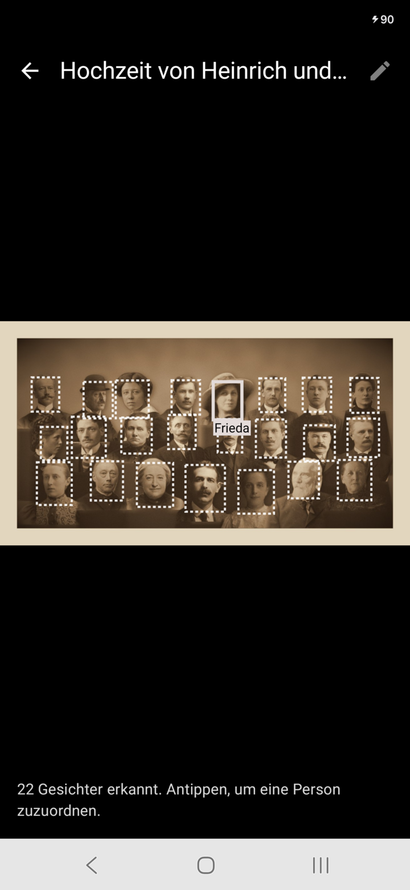
</p>

## Features

- **Tree:** hourglass chart with ancestors, partners and descendants, pan and zoom freely; fan chart across several generations. Choose the number of generations, full screen, back to the previous centre person. Add relatives right from the "+" on a card.
- **Profile:** timeline including marriage and births of children, family, photos, sources, associations, map of places.
- **Search** across all people, plus places, sources, repositories and recent changes.
- **Editing:** people, events, family events, parents, partners, children, citations and associations. If someone else has changed the same record in the meantime, the app notices.
- **Photos and documents:** take or pick, attach to people, set the main picture; photo overview with viewer, PDFs in a built-in viewer.
- **Faces:** the server's face detection suggests boxes, one tap assigns the person.
- **Text recognition** for document photos via the server.
- **History** with undo, **merge** duplicate people.
- **Relationship** between two people, **reports** (PDF) and **export** (e.g. GEDCOM).
- **Anniversaries** with a daily reminder, **AI assistant** (if the server offers it), **offline reading**.
- Phone and tablet; English, German, French, Dutch, Spanish, switchable in the app; classic or light top bar.

The app respects the account's role (guest to owner).

<p>
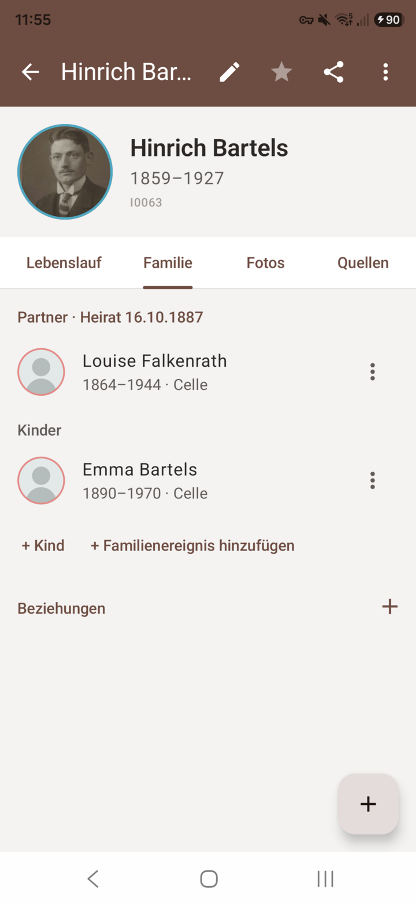
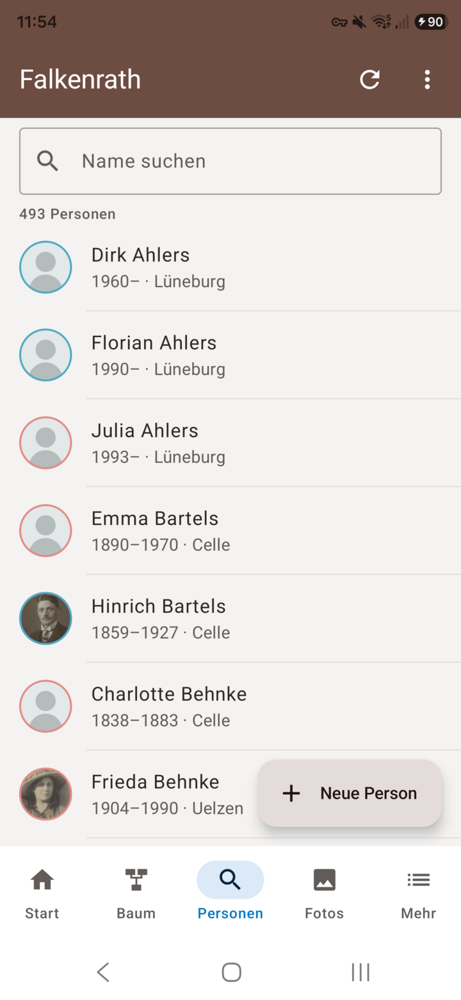
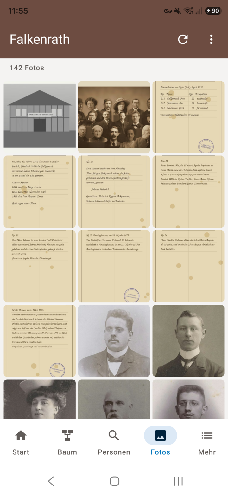
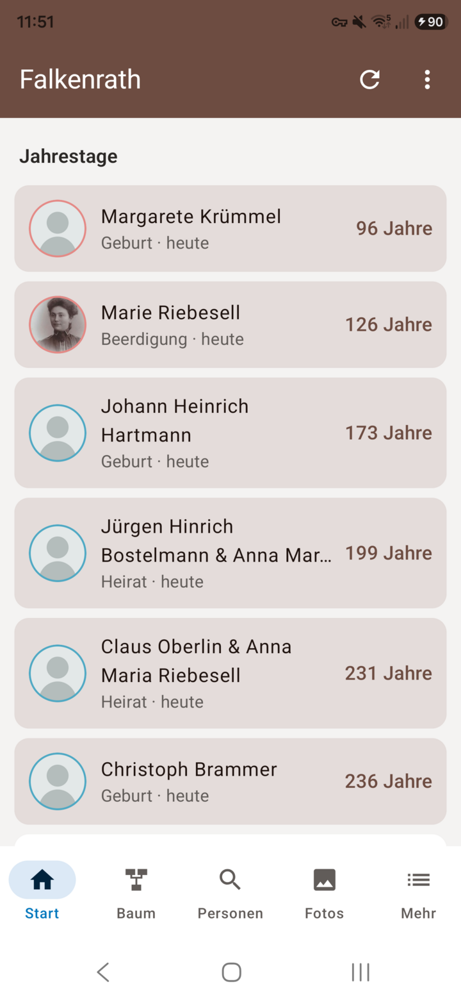
</p>

The screenshots show the fictional demo tree "Falkenrath" from `testdaten/` (German UI).

## New in version 1.2

Choose generations and full screen in the tree, PDFs and other documents with the photos and a built-in PDF viewer,
language and appearance (classic or light) in the menu, anniversaries over 14 days with a "living only" filter.

<p>
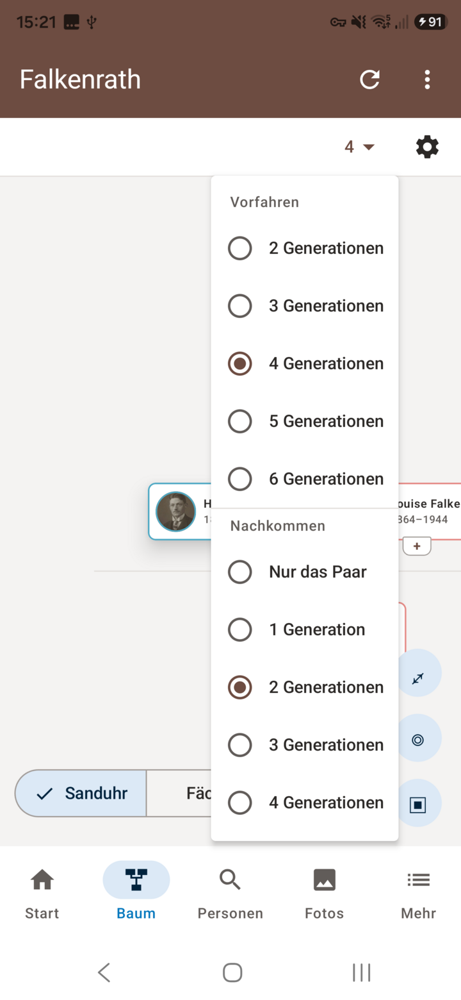
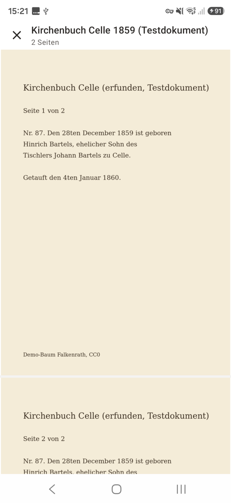
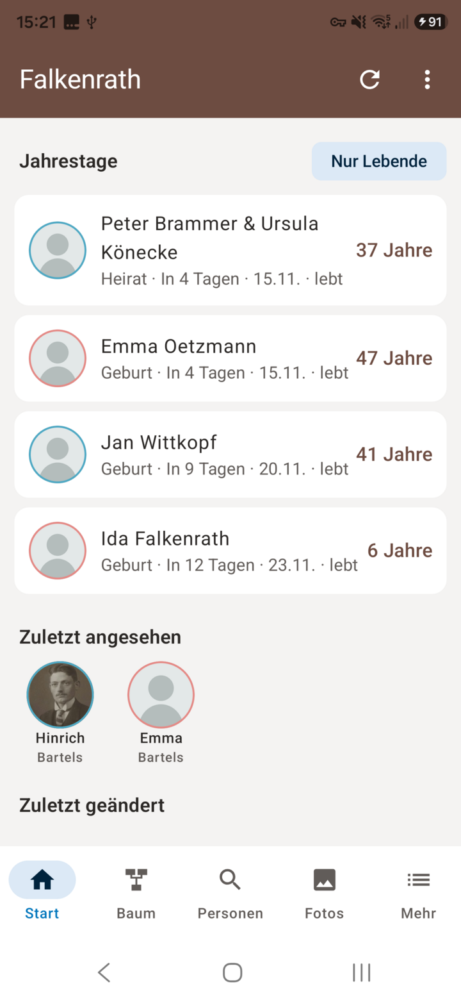
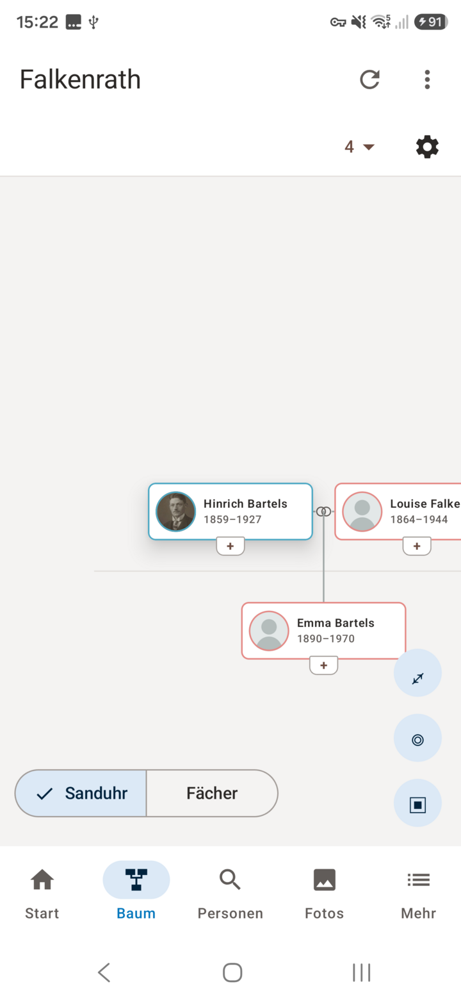
</p>

## Requirements

A Gramps Web server with API 3.0 or later and an account on it. Face and text recognition, reports and the assistant
depend on what the server has enabled. Android 8.0 or later.

Sign-in with user name and password or via OIDC (single sign-on such as Authentik or Keycloak, server with API 3.21 or newer).

## Privacy

The app only talks to the server you enter and loads map tiles from OpenStreetMap. It does not use Google
services. See the [privacy policy](docs/DATENSCHUTZ.md#english).

## Layout

| Folder | Contents |
|---|---|
| `core/` | Gramps Web API client, models, translation into the tree view, ViewModel, screens |
| `app/` | Android shell |
| `app4webtrees/` | git submodule; gwAnd reuses building blocks and the tree view from it |
| `testdaten/` | demo tree Falkenrath (CC0) and recorded responses of a test server |
| `server/` | compose file for a test server |
| `fastlane/` | store texts and images |

## Building

```
git clone --recurse-submodules https://github.com/thobgg/gwAnd.git
cd gwAnd
./gradlew :core:desktopTest :app:assembleRelease
```

Without `keystore.properties` the release build stays unsigned.

## License

GPL-3.0-or-later
