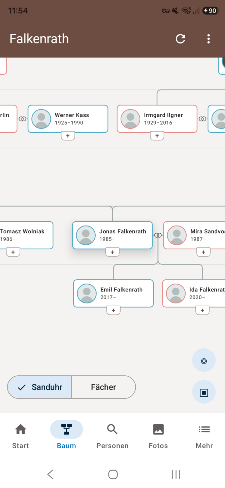
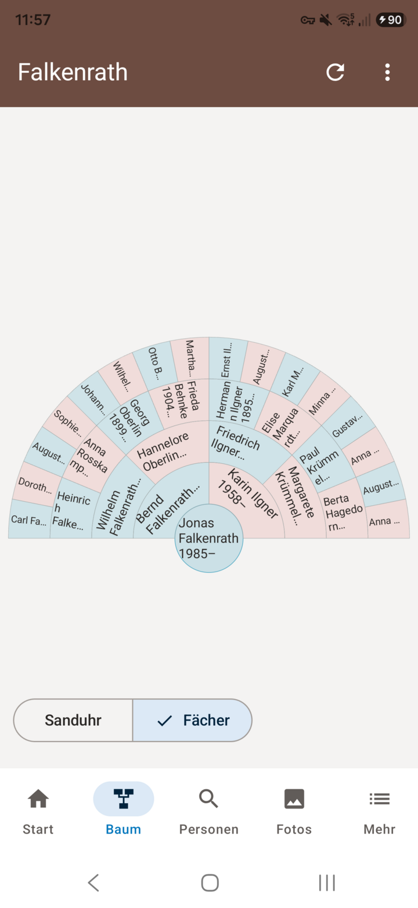
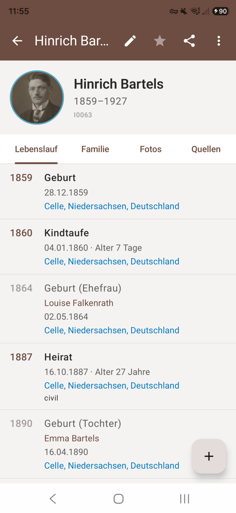
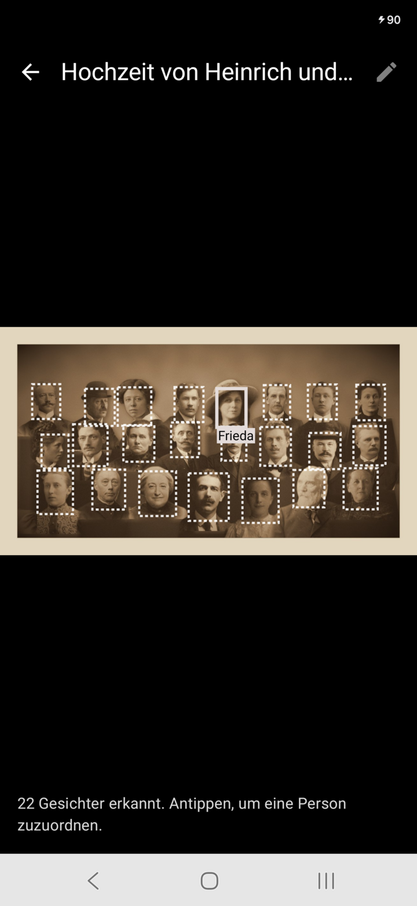
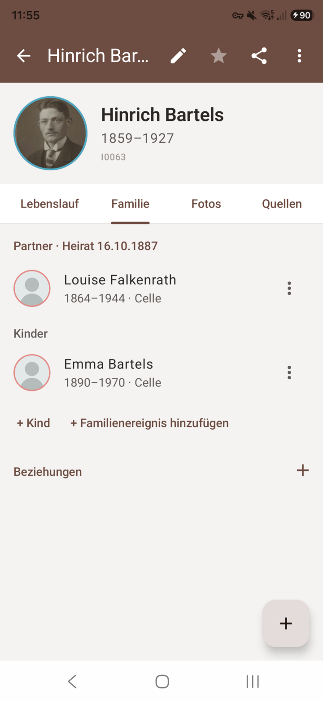
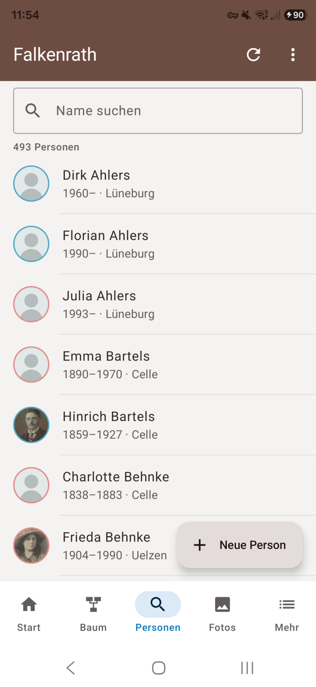
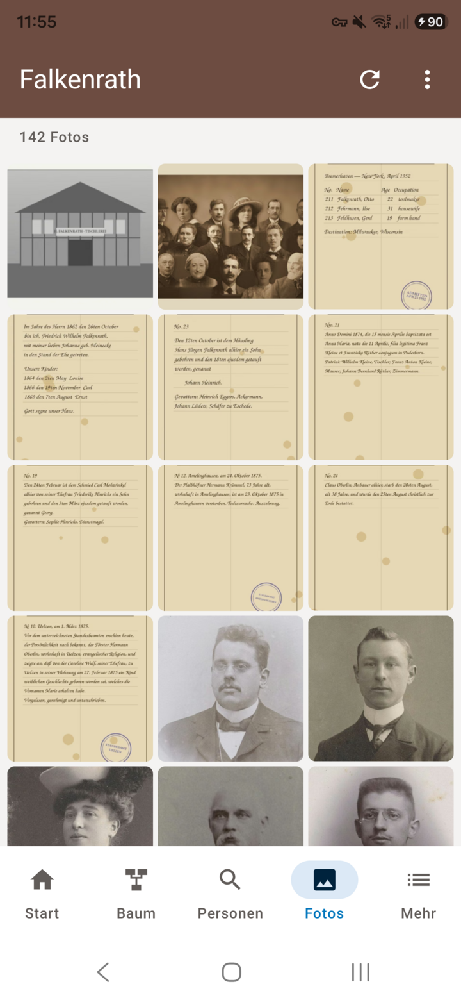
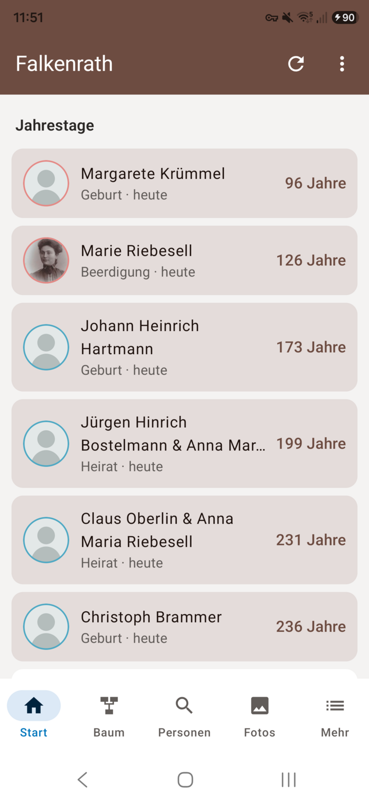

# gwAnd

**Deutsch** · [English](README.en.md)

Native Android-App für Handy und Tablet für [Gramps Web](https://www.grampsweb.org/). gwAnd spricht direkt mit der
Gramps Web API (ab 3.0), ohne eigenen Serverteil, und läuft mit selbst gehosteten Instanzen genauso wie mit gehosteten.

Kein offizielles Projekt von Gramps oder Gramps Web.

<p>




</p>

## Funktionen

- **Baum:** Sanduhr mit Vorfahren, Partnern und Nachkommen, frei verschieben und zoomen; Fächerdiagramm über mehrere Generationen. Verwandte direkt über das „+“ an der Karte anlegen.
- **Profil:** Zeitleiste mit Heirat und Geburten der Kinder, Familie, Fotos, Quellen, Beziehungen, Karte der Lebensstationen.
- **Suche** über alle Personen, dazu Orte, Quellen, Archive und die letzten Änderungen.
- **Bearbeiten:** Personen, Ereignisse, Familienereignisse, Eltern, Partner, Kinder, Zitate und Beziehungen. Hat jemand anderes denselben Datensatz inzwischen geändert, merkt die App das.
- **Fotos:** aufnehmen oder auswählen, an Personen hängen, Hauptbild festlegen; Fotoübersicht mit Betrachter.
- **Gesichter:** die Gesichtserkennung des Servers schlägt Rahmen vor, ein Tipp ordnet die Person zu.
- **Texterkennung** für Dokumentfotos über den Server.
- **Verlauf** mit Rückgängig, **Zusammenführen** doppelter Personen.
- **Verwandtschaft** zwischen zwei Personen, **Berichte** (PDF) und **Export** (z. B. GEDCOM).
- **Jahrestage** mit täglicher Erinnerung, **KI-Assistent** (wenn der Server ihn anbietet), **Lesen ohne Netz**.
- Handy und Tablet; Deutsch, Englisch, Französisch, Niederländisch, Spanisch.

Die App beachtet die Rolle des Kontos (Gast bis Besitzer).

<p>




</p>

Die Bilder zeigen den erfundenen Demo-Baum „Falkenrath“ aus `testdaten/`.

## Voraussetzungen

Ein Gramps-Web-Server ab API 3.0 und ein Konto darauf. Gesichts- und Texterkennung, Berichte und der Assistent
hängen davon ab, was der Server eingeschaltet hat. Android 8.0 oder neuer.

Die Anmeldung läuft mit Benutzername und Passwort. Anmeldung über OIDC (zentraler Anmeldedienst) ist für Version 1.1 geplant.

## Datenschutz

Die App spricht nur mit dem eingetragenen Server und lädt Kartenkacheln von OpenStreetMap. Google-Dienste nutzt sie
nicht. Siehe [Datenschutzerklärung](docs/DATENSCHUTZ.md).

## Aufbau

| Ordner | Inhalt |
|---|---|
| `core/` | Client für die Gramps Web API, Modelle, Übersetzer in die Baumdarstellung, ViewModel, Bildschirme |
| `app/` | Android-Hülle |
| `app4webtrees/` | Git-Submodul; daraus nutzt gwAnd Bausteine und die Baumdarstellung |
| `testdaten/` | Demo-Baum Falkenrath (CC0) und aufgezeichnete Antworten eines Testservers |
| `server/` | Compose-Datei für einen Testserver |
| `fastlane/` | Store-Texte und Bilder |

## Bauen

```
git clone --recurse-submodules https://github.com/thobgg/gwAnd.git
cd gwAnd
./gradlew :core:desktopTest :app:assembleRelease
```

Ohne `keystore.properties` bleibt der Release-Build unsigniert.

## Lizenz

GPL-3.0-or-later
